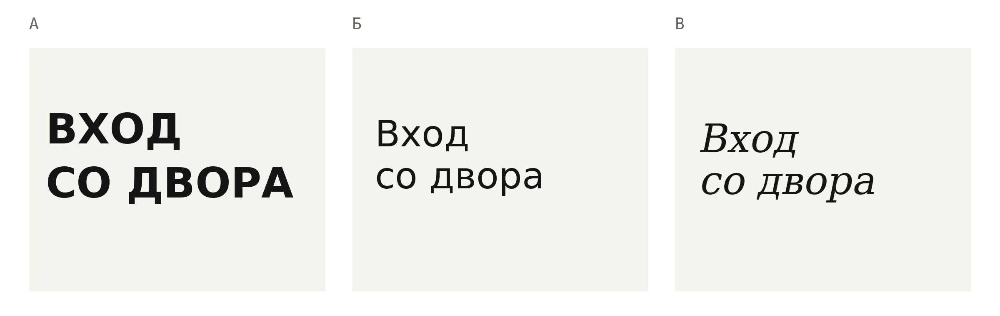
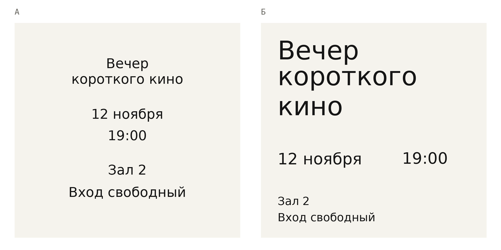
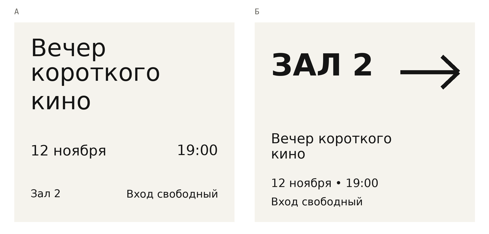
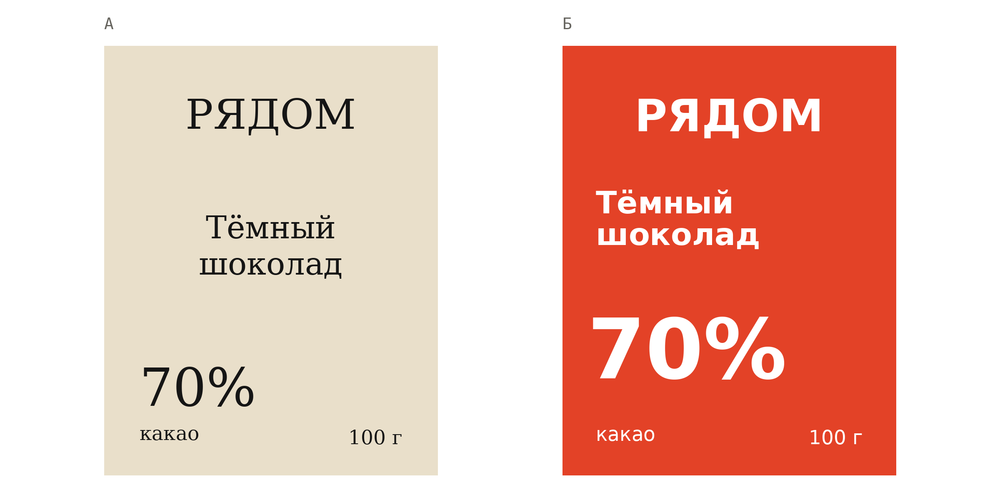
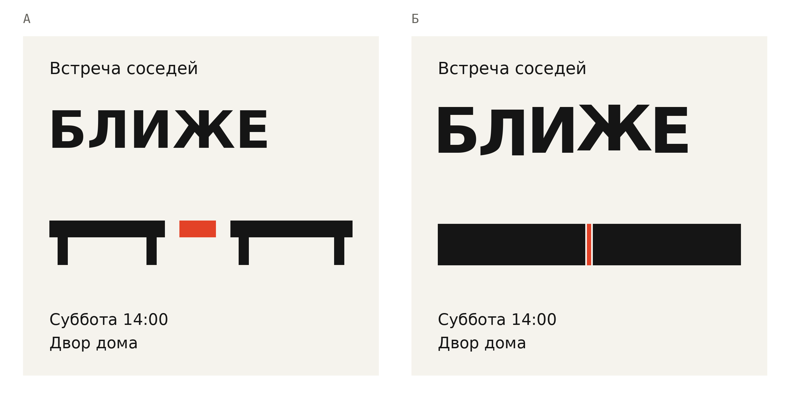
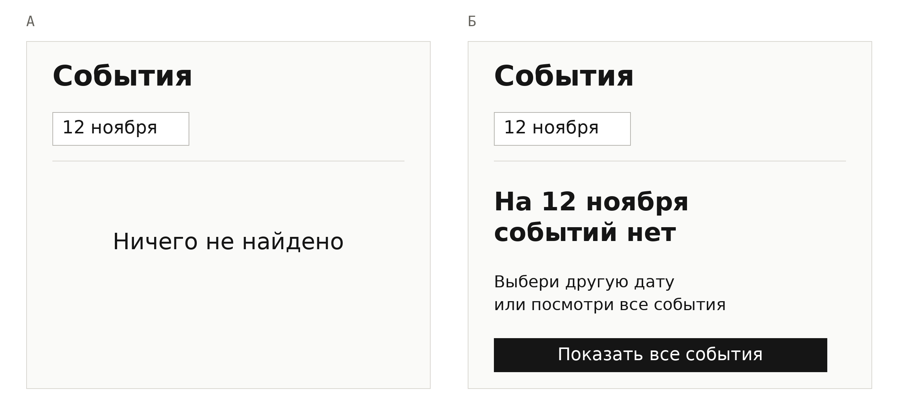

# Почему так

Сергей Отческов

## Предисловие

Я могу посмотреть на аккуратный макет и сказать: «Всё мимо. Давай ещё». Моё настроение из этой фразы понятно. Что переделывать, придётся угадывать.

Бывает, я и сам ещё не разобрался. Вроде ничего не сломано, но смотреть скучно. Или красиво, а пользоваться неудобно. Или на экране столько всего, что уже хочется попросить обычный лист бумаги. Потом начинаешь разбирать работу и обнаруживаешь вполне конкретную причину: заголовок обещает одно, картинка показывает другое, нужная кнопка скромно прячется внизу.

Я занимаюсь сайтами, презентациями, фирменным стилем и интерфейсами. Люблю минимализм, требую доводить детали и могу довольно долго не принимать результат, который выглядит почти готовым. Слово «почти» обычно означает, что кто-то ещё будет с ним разбираться. Желательно до того, как туда придёт человек со своими делами.

Эта книга выросла из желания объяснить, что именно я вижу в таких работах. Для этого пригодятся вещи, с которыми мы встречаемся без всякого дизайнерского образования: вывеска, упаковка шоколада, объявление в подъезде. В них хватает странностей, удачных находок и решений, которые хочется покрутить в руках.

Раздражение здесь тоже будет. Но меня привлекают и вещи, с которыми всё хорошо: обложка, которую продолжаешь рассматривать после того, как прочёл название; вывеска, которую узнаёшь по одной букве. Хочется понять, как это получилось, а потом увидеть, что изменится, если эту букву заменить.

Начнём с двери. На ней, как водится, всё написано.

## Глава 1

### На двери всё написано

Представь: ты пришёл в незнакомое место и дёрнул дверную ручку. Закрыто. Уже собираешься достать телефон, когда замечаешь листок: «Вход со двора».

Вот же он, перед глазами. Висит среди часов работы, наклейки платёжной системы и ещё какого-то объявления. После того как прочитал, пропустить его кажется невозможным. До этого почему-то получилось.

К расположению мы ещё вернёмся. Сначала заберём с двери три слова и напишем их по-разному.

*Рисунок 1. Одна фраза в трёх оформлениях. Меняются шрифт, регистр и расположение слов.*

Первый вариант я читаю почти как команду. Второй спокойно сообщает, куда идти. Третий с наклонными буквами кажется мне подходящим для небольшого кафе: будто со мной уже разговаривают чуть мягче. Пока за этими надписями нет ни кафе, ни двора. Я успел придумать их по буквам.

Самое интересное начинается, если перенести первую надпись на большой вокзал. Там её плотность и размер могут оказаться очень кстати. Мне нужно увидеть направление издалека, и деликатный шрифт окажет довольно сомнительную услугу. А небольшому кафе крупные тяжёлые буквы могут понадобиться именно потому, что его вход всё время проходят. По одному начертанию ещё не узнать, уместна ли надпись.

Я могу точно назвать, чем варианты отличаются: размером, толщиной линий, расстояниями. А слова «жёстко» и «мягко» уже описывают мою реакцию. У другого человека она может быть иной. Я вижу небольшое кафе, а он вспоминает вывеску учреждения, где встречал такие же буквы.

### Пока мы выбирали шрифт

Человек у двери всё ещё хочет войти. Мы можем подобрать надписи прекрасную интонацию и повесить её так, что он опять начнёт с ручки.

Если листок теряется среди объявлений, стоит вынести его отдельно. Если его закрывает открытая створка, нужно другое место. Если во двор ведут две арки, слова «со двора» оставляют ещё одну задачу. В каждой из этих ситуаций правка будет своей. Просто сделать буквы жирнее можно, но арку они за нас не выберут.

Я начинаю с того момента, в котором человек застрял. Что он искал? Куда посмотрел? На что рассчитывал? С такого разбора иногда приходится вернуться к тексту. «Вход со двора» может оказаться недостаточным сообщением, как бы хорошо мы его ни набрали.

При этом новая стрелка тоже требует внимания. Её легко поставить, глядя на макет перед собой, и забыть, откуда к табличке подходят. На стене знак окажется выше, свет будет другим, рядом появится открытая дверь. У картинки на экране очень удобные условия: мы уже знаем, куда смотреть.

### Семь вечера

Для следующего примера возьмём вымышленный вечер короткого кино. Двенадцатое ноября, начало в семь, второй зал, вход свободный. На афише нужно уместить всё это так, чтобы человек понял, куда его зовут и получится ли прийти.

Сведения в двух вариантах одинаковые. Распорядились мы ими по-разному.

*Рисунок 2. Два варианта афиши с одинаковым текстом. Во втором сильнее выделено название, дата и время собраны в одну строку.*

Слева строки стоят одна под другой и мало спорят за внимание. Можно прочесть их сверху вниз и во всём разобраться. Справа название заметно крупнее. У даты и времени есть своя строка, у зала и условий входа своё место. Я вижу, где закончилась одна часть сообщения и началась другая.

Такое распределение заметности называют иерархией. Здесь название знакомит с событием, дата помогает свериться с планами, а номер зала пригодится уже на месте. Один лист должен ответить на несколько вопросов, но одновременно задавать их никто не обязан.

Если хочется выделить всё сразу, легко прийти к варианту, в котором всё крупное, жирное и красное. Буквы займут больше места, а различий между сообщениями не прибавится. Поэтому я сначала решу, какое сообщение должно встретить человека первым. Остальным тоже понадобится место, только своё.

На нашей афише пока мало текста. Добавим описание программы, имена участников, логотипы организаторов, возрастное ограничение. Чистая композиция быстро перестанет быть чистой. Теперь особенно пригодится сделанное раньше разделение: можно добавлять подробности рядом с тем, к чему они относятся, и не заставлять название, время и партнёров конкурировать одинаково громко.

Есть соблазн сразу объявить правый вариант более удобным. Я бы начал с проверки: показал обе афиши людям, которые их ещё не видели, и попросил найти время. По рисунку можно сравнить размеры и группировку. Скорость поиска мы пока не измеряли.

А вот замечание к макету уже можно сформулировать точно: «Я ищу время, а оно теряется среди остальных строк». После этого есть что передвигать и с чем сравнивать результат. Фраза «надо поживее» оставила бы нам куда больше свободы. В том числе свободу исправить совсем не то.

### Через пять минут начало

Теперь ты уже пришёл на показ. Время помнишь, название тоже, а перед тобой коридор и несколько дверей. На стене висит знакомая афиша.

«Вечер короткого кино» видно отлично. С названием мы справились. Только сейчас оно почти ничего не решает: нужен второй зал и направление к нему.

Я беру те же сведения и переставляю акценты.

*Рисунок 3. Слева афиша события, справа указатель для коридора. Во втором варианте на первом месте зал и направление.*

У указателя крупные цифра и стрелка. Название остаётся, чтобы посетитель мог проверить, туда ли пришёл. Дата и время тоже на месте, но уже не требуют первого взгляда.

Рядом эти варианты легко принять за «до» и «после». Хотя правый не заменяет левый. Если вывесить в ленте событий огромную надпись «ЗАЛ 2», человеку сначала придётся выяснить, зачем ему вообще этот зал. Афиша приглашает на фильм, указатель помогает к нему дойти.

На двери надпись тоже можно прочитать по-разному: с метра, из конца коридора, через отражение в стекле. Поэтому к красивой версии полезно подойти с того места, где окажется посетитель. Иногда достаточно этого, чтобы перестать спорить о шрифте и перевесить листок.

Для нашего кинопоказа я оставлю афишу у входа, а указатель повешу перед развилкой. Название по-прежнему будет крупным там, где оно нужно. Стрелка появится раньше, чем человек выберет дверь.

Он свернёт направо и успеет к началу. На плакат ещё можно посмотреть после фильма.

## Глава 2

### Красиво и что дальше

В этих двух упаковках лежит одинаковый шоколад. Один и тот же состав, семьдесят процентов какао, сто граммов. Название тоже одно: «Рядом».

Какую плитку ты взял бы себе, а какую понёс в подарок?

*Рисунок 4. Вымышленные упаковки одного шоколада. Состав, масса и название одинаковые; различается оформление.*

Мне бежевая кажется более спокойной, красная заметнее и напористее. Если я выбираю подарок, то уже представляю, как достану упаковку из пакета и протяну человеку. Здесь внешность вполне участвует в выборе. Съедобное содержимое пока даже не открывали.

Может оказаться, что в подарок я возьму именно красную: знаю человека, которому она понравится. А спокойную оставлю себе. Решение зависит от того, кому я собираюсь её вручить. Слово «премиально», сказанное над бежевым макетом, само по себе этого человека не описывает.

По цвету обёртки нельзя узнать вкус шоколада. Зато можно увидеть, каким его решили представить. В одном варианте название набрано тонкими буквами с засечками, в другом крупные белые буквы стоят на ярком фоне. Мне интересно, как из этих простых различий мы успеваем сделать выводы о целой вещи.

Оформление ещё понадобится проверить в другом окружении. На отдельном белом листе красная плитка выделяется сразу. А на полке вокруг неё могут стоять ещё десять красных упаковок. Бежевую захочется рассмотреть с другого расстояния. Два аккуратных макета пока не рассказывают, что произойдёт в магазине, и не предсказывают продажи.

Но удовольствие от выбранной обёртки уже есть. Сам шоколад мы ещё не попробовали, а упаковку уже приятно подарить. В этой покупке внешний вид тоже имеет значение.

### Собрать соседей

С приглашением похожая история: человек ещё никуда не пришёл, но уже пытается представить, что его ждёт. Возьмём встречу соседей во дворе и назовём её «Ближе». Суббота, два часа дня. За столами можно познакомиться с людьми, с которыми обычно только здороваешься у лифта.

Просто сообщить время мало. Хочется, чтобы на встречу пришли люди, которые ещё не уверены, надо ли им знакомиться с соседями. Торжественное оформление здесь меня бы насторожило. Возможно, я ожидал обычного разговора за столом и пока не собирался к нему готовиться.

*Рисунок 5. Два эскиза приглашения на вымышленную встречу. Справа буквы и простые формы стоят плотнее.*

В левом варианте между буквами есть расстояние, внизу отдельно стоят две формы, похожие на столы. Справа название собрано плотнее, а две тёмные полосы почти сошлись, оставив между собой узкую красную. Сближение видно. Только полосы получились тяжёлыми: для меня они скорее складываются в перегородку. Пока я объяснял идею, на картинке успело появиться что-то другое.

В правом варианте я бы продолжил работу с названием. В нём расстояния связаны со словом, и на этом можно построить плакат. Однако на небольшом листке у лифта тесные буквы могут начать сливаться. Тогда придётся менять размер, расстояния или само начертание. Идею хочется сохранить, а слово всё-таки прочитать.

У этого приёма есть предел. Если придвинуть буквы ещё сильнее, приглашение не станет ещё дружелюбнее. В какой-то момент получится чёрное пятно. Здесь уже не поможет объяснение про сближение: мы просто перестарались.

Я люблю такие задачи за то, что решение можно потрогать. Поменял промежуток, и название стало вести себя иначе. А если вся выразительность держится на рассказе автора о том, какой смысл он вложил, мне хочется посмотреть на плакат ещё раз. Соседи этот рассказ не услышат.

### Что здесь можно убрать

Теперь начинается уборка. Хочется сделать плакат свободнее, убрать лишние элементы и оставить побольше воздуха. Я сам люблю минимализм, поэтому отлично понимаю это желание.

Начну с названия. Допустим, мы решили увеличить промежутки: так слово читается свободнее. Заодно исчезла теснота, из-за которой оно поддерживало приглашение. Я бы открыл обе версии рядом. Возможно, более свободная нам действительно подходит. Но теперь хотя бы видно, что именно мы потеряли.

С нижними полосами можно поступить жёстче. Если они напоминают перегородку, я попробую убрать их совсем или вернуть узнаваемые столы. Служебным строкам при этом нужно оставить место. Маленькое «14:00» сообщает то, чего нельзя восстановить по остальному плакату.

Если после уборки остаются пустое поле и заголовок, я ещё не считаю работу законченной. Мне нужно за что-то зацепиться взглядом. Иногда хватает одного слова, иногда фотографии. А иногда мы убрали почти всё просто потому, что так легче добиться аккуратности.

### Если добавить людей

Вместо тяжёлых полос можно показать тех, кого мы приглашаем. Тут очень легко поставить рядом с текстом фотографию улыбающейся компании и считать, что тема раскрыта. Люди есть, улыбки тоже. К нашим соседям они пока отношения не имеют.

Если на снимке реальные участники встречи, это уже другое дело. Человек может узнать соседа или место, куда его зовут. У фотографии появляется конкретная работа. Я тогда посмотрю, кого видно, что происходит между людьми, есть ли в кадре подробность, которая говорит об этой встрече.

Для вымышленного приглашения можно поискать другой образ. Например, скамейку со свободным местом. Или руки, которые придвигают к общему столу ещё один стул. В обоих случаях приглашение можно заметить до чтения подписи. Но хороший замысел ещё придётся снять или нарисовать. Пустая скамейка может выглядеть так, будто все уже ушли. Стул можно придвигать для нового гостя или убирать после праздника. Ракурс и детали поменяют историю.

Мне часто не хватает именно этой работы, когда приносят очередную гладкую картинку. В тексте люди, рядом люди. В тексте технологии, рядом что-нибудь блестит. Материал проработан замечательно, а зачем объект попал на страницу, непонятно.

Я могу попросить двадцать вариантов у нейросети и получить двадцать красивых скамеек. Деревянную, металлическую, прозрачную. Потом ещё десять с хорошим светом. Вариантов много, а приглашение через свободное место мы проверяем всё то же. Чтобы появилась другая идея, придётся подумать о другом действии или образе.

Поэтому я сравниваю сначала сами предложения: сближённые буквы, фотографию соседей, место за столом. Когда выбрал подход, можно разбираться с материалом и светом. Иногда они и подсказывают новый поворот, но от простого увеличения количества картинок он не возникает автоматически.

Это относится и к работе без нейросети. Ручной труд способен произвести ровно такую же пустую красоту. Мне нравится многое из того, что можно сделать новыми инструментами, но в конце всё равно придётся выбрать одну вещь и объяснить себе, зачем она нужна.

### А потом человек нажал

Допустим, для встреч во дворе сделали сайт. В приглашении есть адрес, человек заходит посмотреть расписание. На первом экране всё хорошо: фотография, короткий текст, понятная кнопка. Пока на странице ровно столько слов, сколько помещалось в макете.

Потом добавляют длинное название другой встречи. Оно занимает три строки и сдвигает кнопку. На телефоне подпись налезает на фотографию. Человек ведь не обещал писать покороче ради нашей аккуратной карточки.

Я поэтому и прошу доводить работу дальше первого экрана. Нужно увидеть её с другим текстом, на узком экране, при пустом списке. Плакат уже приходилось уменьшать, и сайт тоже будут открывать в условиях, которые мы заранее себе не подобрали.

Вот один из таких случаев. На странице событий человек выбирает двенадцатое ноября. На эту дату встреч нет, и сайт отвечает: «Ничего не найдено».

*Рисунок 6. Учебный экран поиска. Справа названа выбранная дата и предложен переход к полному списку событий.*

Слева фраза аккуратно стоит посередине. Она сообщает результат поиска, но дальше посетитель разбирается сам. Справа понятно, что пустой список относится к выбранной дате. Можно сменить её или нажать «Показать все события».

Для этой правки не понадобилась новая фотография. Мы добавили объяснение и действие. Если за кнопкой откроется расписание, человек сможет продолжить то, ради чего зашёл. А если она никуда не ведёт, у нас пока только рисунок исправления.

## К темам первых глав

Эллен Луптон. Thinking with Type. Разбор шрифта, интервалов и композиции на визуальных примерах. Страница издателя: https://papress.com/products/thinking-with-type-3-edition

Дон Норман. The Design of Everyday Things. О том, как люди разбираются с привычными вещами и почему ошибаются при использовании. Страница издателя: https://mitpress.mit.edu/9780262525671/the-design-of-everyday-things/
